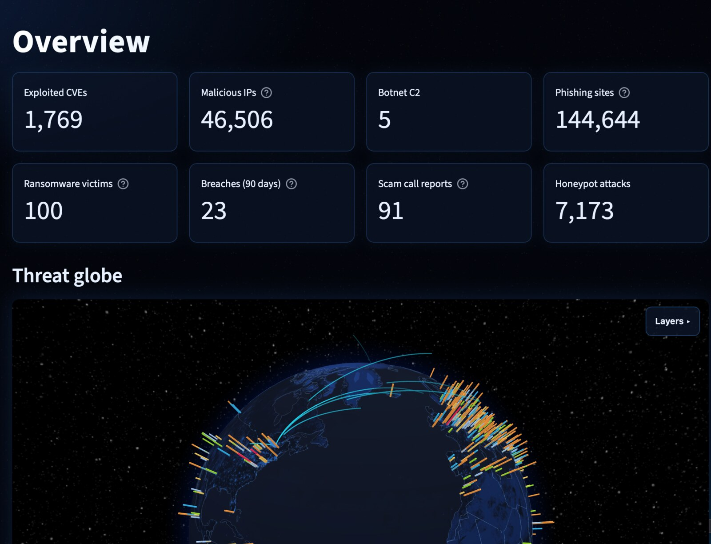
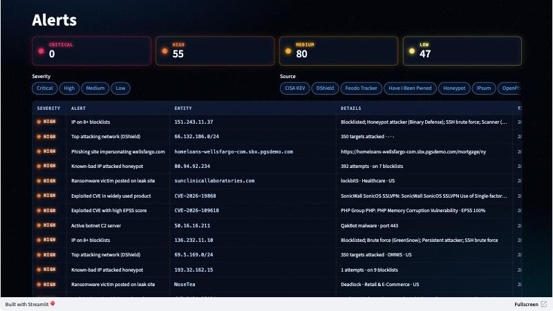
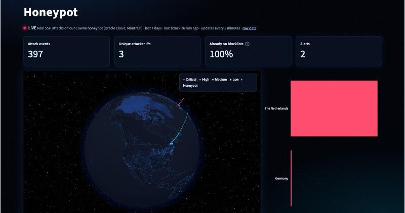
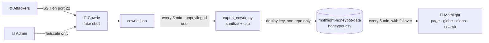

<div align="center">


<br>

<a href="https://mothlight.streamlit.app"></a>
<a href="https://github.com/realzephaniahjohnson/mothlight-honeypot-data"></a>


**[Live demo](https://mothlight.streamlit.app)** · **[Features](#-features)** · **[Live honeypot](#-live-honeypot)** · **[Reports](#-reports)** · **[Detections](#-detection-rules)** · **[Data sources](#-data-sources)** · **[Team](#-team)**

</div>

---

**Mothlight** is an OSINT threat intelligence SIEM with its own live SSH honeypot. It pulls 19 free threat feeds into one
place, raises alerts from 24 detection rules, maps everything on a 3D threat globe, and lets you hunt with **KQL**,
**SPL**, or **SQL**. Drop in any IP, CVE, email, phone number, or domain and it returns a verdict with the evidence.

<p align="center"></p>

## ✨ Features

| | Page | What it does |
|:-:|---|---|
| 🌍 | **Overview** | KPIs and a 3D night-side threat globe: countries glow by how many malicious IPs they host, with malicious IPs by attack type, ransomware victims, US scam calls, pulsing alert rings, and live honeypot attack arcs |
| 🚨 | **Alerts** | Detections from 24 rules across 4 severities, filterable by severity and source |
| 🔎 | **Search** | Hunt in KQL (Microsoft Sentinel), SPL (Splunk), or SQL, with the translated SQL shown, an event timeline, a schema browser, and CSV export |
| 🕵️ | **Investigate** | One box for any indicator: auto-detects IPs, CVEs, emails, phone numbers, and domains, then returns a verdict, risk score, and evidence |
| 🍯 | **Honeypot** | Real SSH attacks on our Cowrie honeypot, updated every 5 minutes: attackers on a map, attacks per hour, and the usernames, passwords, and commands they tried |
| 🔌 | **Connectors** | Health, record counts, and refresh status for every data source |

<table>
<tr>
<td width="50%"><p align="center"><sub>Alert queue with neon severity cards</sub></p></td>
<td width="50%"><p align="center"><sub>Live honeypot: real attackers, updated every 5 minutes</sub></p></td>
</tr>
</table>

### 🧠 Query engine

KQL and SPL are translated into SQL and run on an in-memory SQLite database, and the translated SQL is shown for every
search. Every query runs on a private read-only copy: only `SELECT` is allowed, attached databases and writes are
blocked, results are size-capped, and queries are cancelled after 10 seconds.

### 📞 Phone and email checks

These are **reputation checks**: they show whether a number, address, or domain is linked to scams, spam, or phishing,
not who owns it.

- **Phone:** FTC scam and robocall reports, validity, line type (VoIP, toll-free, premium rate), region, fraud score
- **Email / domain:** live phishing hosting, disposable providers, brand-impersonation lookalikes, domain age, MX/SPF/DMARC records, fraud score

## 🍯 Live honeypot

Mothlight shows live attacks on our own [Cowrie](https://github.com/cowrie/cowrie) SSH honeypot, a fake server on an
Oracle Cloud VM in Montreal that exists only to be attacked.



- **Least privilege:** the exporter runs as its own user with a key that can only write to the data repo.
- **Nothing private leaks:** private IPs, our own addresses, and server details are stripped before publishing.
- **Untrusted by default:** everything in the data was typed by attackers, so it's size-capped, validated, and only shown escaped.
- **No public admin door:** the real SSH port is reachable only over Tailscale.
- **Raw data is public:** [mothlight-honeypot-data](https://github.com/realzephaniahjohnson/mothlight-honeypot-data).

## 📝 Reports

Write-ups from our own honeypot data: what attacked us, what they did, and how it maps to MITRE ATT&CK.

| Date | Report | Highlights |
|---|---|---|
| Nov 9, 2026 | [Our first 12 hours under attack](reports/2026-11-09-first-12-hours.md) | 6,003 events from 14 IPs · a 1,197-login census bot · bots that test for honeypots · a hidden-file dropper |

## 🚨 Detection rules

| Severity | Rule |
|---|---|
| 🔴 **Critical** | Ransomware-linked CVE added to CISA KEV in the last 7 days |
| 🔴 **Critical** | Botnet command-and-control server attacked the honeypot |
| 🟠 **High** | Ransomware-linked CVE added in the last 30 days |
| 🟠 **High** | Exploited CVE in a widely used product (Fortinet, Ivanti, Cisco, Microsoft...) in the last 14 days |
| 🟠 **High** | Botnet C2 server is online |
| 🟠 **High** | IP on 8+ public blocklists |
| 🟠 **High** | Phishing site impersonating a bank, crypto exchange, PayPal, or the IRS |
| 🟠 **High** | Scam number with a large spike in FTC reports |
| 🟠 **High** | IP on 5+ blocklists attacked the honeypot |
| 🟡 **Medium** | Any other CVE added in the last 14 days |
| 🟡 **Medium** | Attacker seen doing 3+ kinds of attacks |
| 🟡 **Medium** | Phishing site impersonating any other major brand (lookalike detection) |
| 🟡 **Medium** | Mass-reported scam number |
| 🟡 **Medium** | 100+ attempts from one IP against the honeypot |
| ⚪ **Low** | CVE added 15 to 30 days ago |
| ⚪ **Low** | Tor exit node with abuse reports, or attacking the honeypot |
| ⚪ **Low** | Phishing page hosted on a free platform (Vercel, GitHub Pages, Netlify...) |

## 📡 Data sources

<details>
<summary><b>19 feeds and 6 enrichment services</b> (click to expand)</summary>

<br>

| Source | Table | What it provides | Key |
|---|---|---|---|
| [CISA KEV](https://www.cisa.gov/known-exploited-vulnerabilities-catalog) | `kev` | Vulnerabilities exploited in the wild | No |
| [IPsum](https://github.com/stamparm/ipsum) | `malicious_ips` | IPs on 30+ public blocklists, with a score | No |
| [abuse.ch Feodo Tracker](https://feodotracker.abuse.ch/) | `botnet_c2` | Botnet command-and-control servers | No |
| [blocklist.de](https://www.blocklist.de/en/export.html) | `attack_reports` | IPs caught attacking servers, by type (SSH, web, mail, FTP, SIP...) | No |
| [CINS Army](https://cinsarmy.com/) | `cins_army` | IPs with very poor reputation, mostly scanners | No |
| [Tor Project](https://check.torproject.org/torbulkexitlist) | `tor_exits` | Current Tor exit nodes | No |
| [GreenSnow](https://greensnow.co/) | `greensnow` | IPs caught brute-forcing and scanning | No |
| [Binary Defense](https://www.binarydefense.com/banlist.txt) | `binary_defense` | IPs hitting their honeypots (non-commercial use) | No |
| [SANS ISC DShield](https://isc.sans.edu/) | `top_attacking_subnets` | Top 20 attacking networks of the last 3 days (CC BY-NC-SA) | No |
| [Spamhaus DROP](https://www.spamhaus.org/blocklists/do-not-route-or-peer/) | `hijacked_netblocks` | Hijacked or criminal-run networks | No |
| [Ransomware.live](https://www.ransomware.live/) | `ransomware_victims` | Latest victims posted on ransomware leak sites | Free key (ransomware.live/my) |
| [Have I Been Pwned](https://haveibeenpwned.com/PwnedWebsites) | `data_breaches` | Public data breach catalog | No |
| [FIRST EPSS](https://www.first.org/epss/) | `epss` (also on `kev`) | Chance each exploited CVE gets used in the next 30 days | No |
| [Phishing Army](https://phishing.army/) + [CERT Polska](https://cert.pl/en/warning-list/) | `phishing_domains` | Phishing and scam domains (personal use) | No |
| [SANS ISC DShield API](https://isc.sans.edu/api/) | `dshield_top_ips` | Top 1,000 attacking IPs worldwide | No |
| [IPtoASN via ip-location-db](https://github.com/sapics/ip-location-db) | — | Registered country for every IP, offline (public domain) | No |
| All IP feeds combined | `ip_intel` | One row per IP: attack type, every feed it's in, blocklist score, risk score | — |
| [OpenPhish Community](https://github.com/openphish/public_feed) | `phishing_urls` | Live phishing URLs (non-commercial use) | No |
| [FTC Do Not Call data](https://www.ftc.gov/policy-notices/open-government/data-sets/do-not-call-data) | `scam_calls` | Phone numbers reported for unwanted calls (daily CSVs, or the official FTC API as a fallback) | Optional (api.data.gov) |
| [disposable-email-domains](https://github.com/disposable-email-domains/disposable-email-domains) | `disposable_domains` | Throwaway email providers | No |
| [Our Cowrie honeypot](https://github.com/realzephaniahjohnson/mothlight-honeypot-data) | `honeypot` | Live SSH attacks: login attempts, commands, and malware downloads (updated every 5 minutes) | No |
| ip-api.com, Shodan InternetDB, Google DNS, RDAP | — | Enrichment in Investigate | No |
| [AbuseIPDB](https://www.abuseipdb.com/), [IPQualityScore](https://www.ipqualityscore.com/) | — | Extra scores in Investigate | Optional, free |

</details>

## 🛡️ Security and privacy

- **No tracking:** no accounts, ads, analytics, or keystroke logging, and Streamlit usage stats are off.
- **Keys stay server-side:** API keys never reach the browser and are redacted from every error message.
- **Hardened:** rate limiting, a sandboxed read-only query engine, escaped output, upload limits, and spreadsheet-formula protection on exports.
- **Policies:** full [Privacy Policy and Terms](https://mothlight.streamlit.app/privacy) on the site, and a [security policy](SECURITY.md) for reporting issues.

## 🎯 Skills demonstrated

`Threat intelligence` `Detection engineering` `Alert triage` `KQL` `SPL` `SQL` `IOC enrichment` `Phishing analysis`
`Honeypot operations` `Log pipelines` `Cloud (Oracle)` `Zero-trust admin (Tailscale)` `Secure coding` `Python`

## 🗂️ Project structure

```
app.py            pages, alerts, charts, and layout
feeds.py          downloads, caches, and cleans each data feed
query_engine.py   KQL/SPL-to-SQL translator and sandboxed query runner
checks.py         reputation checks for IPs, CVEs, emails, phones, and domains
globe3d.py        3D night-lights threat globe (globe.gl / WebGL)
legal.py          privacy policy and terms
honeypot/         export job that runs on the honeypot VM
reports/          write-ups of real attacks on our honeypot
assets/           logo, banner, and screenshots
```

## 👥 Team

<div align="center">


**Designed and built by**

**Zephaniah Johnson** · **Zakari Gilmer** · **Bofelo Gaeonale**

<sub>🦋 They always come to the light.</sub>

</div>
