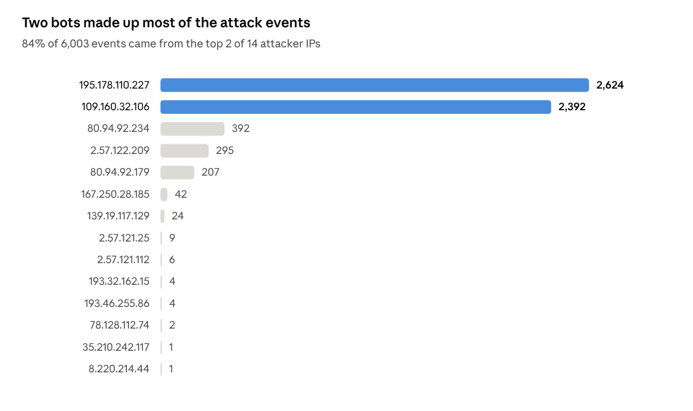

# Mothlight Honeypot Report: Our First 12 Hours Under Attack

Nov 9, 2026 · Zephaniah Johnson, Zakari Gilmer and Bofelo Gaeonale

## Summary

We turned our Cowrie honeypot on early on November 9. Over the next 12 and a half hours it got hit 6,003 times from 14 IP addresses, across 1,350 SSH sessions. Almost none of that was a person at a keyboard. It was bots guessing passwords, looking around once they got in, checking whether the machine was even real, and in a few cases starting to drop files.

Three things jumped out at us. One bot logged in 1,197 times just to run `uname`. Two others ran a long list of tests to figure out if they were inside a honeypot before doing anything else. And three IPs tried to make a hidden file executable using `sudo` and the password they'd just guessed. The data covers Nov 9, 2026, from 02:26 to 14:52 UTC. We opened the Telnet ports at 14:40, so this is almost all SSH traffic.

## How it works

A honeypot is a fake server that exists to get attacked. Here's how ours feeds into Mothlight.

1. [Cowrie](https://github.com/cowrie/cowrie) pretends to be an SSH server on ports 22, 2200, 2222 and 8022, and a Telnet server on 23 and 2323. It runs on an Oracle Cloud VM in Montreal. If an attacker guesses a password they get a fake shell, and nothing they run touches the real system.
2. Cowrie writes every connection, password guess and command to a JSON log.
3. Every 5 minutes, a script running under its own limited user pulls out the attacker activity, strips out our own IPs and any private traffic, and pushes it to a [public data repo](https://github.com/realzephaniahjohnson/mothlight-honeypot-data). The key it uses can only write to that one repo.
4. [Mothlight](https://mothlight.streamlit.app) picks up the new data every 5 minutes. It shows up on the Honeypot page, as attack lines on the globe, in the alerts, and as a `honeypot` table we can search.

The real admin login on the VM only works over Tailscale, so attackers never even see it.

## By the numbers



Out of 1,362 login attempts, 1,332 worked. That's on purpose. Cowrie lets almost any root password through so we can watch what attackers do once they're in, and they ran 4,641 commands. We didn't catch any malware downloads during this window.

| Rank | Username tried | Tries | Password tried | Tries |
| --- | --- | --- | --- | --- |
| 1 | root | 502 | 123456 | 77 |
| 2 | admin | 81 | 123 | 40 |
| 3 | ubuntu | 38 | 1234 | 33 |
| 4 | user | 25 | (blank) | 26 |
| 5 | deploy | 23 | 12345678 | 22 |

These are the same usernames and passwords every bot tries: default accounts and the weakest passwords out there. Someone even tried a blank password 26 times.

## Attacker stories

### 1. The census bot: 1,197 logins, one command each

`109.160.32.106` logged in 1,197 different times, with a new username and password combo every time (416 different usernames, mostly root, plus things like `operator` / `operator2026`). Each time it ran one command and left:

```bash
uname -s -v -n -r -m
```

That command prints the OS, kernel version, hostname and CPU type. This bot isn't attacking anything yet. It's taking inventory of which logins work and what's behind them. Our guess is the list gets used later, either by the same group or by whoever buys it, to pick the right malware for each machine.

### 2. The honeypot detectors: "is this shell real?"

`195.178.110.227` (89 sessions) and `80.94.92.234` (12 sessions) logged in as root and ran the same script every time, 25 to 41 commands in a few seconds. The tests looked like this:

- A math problem like `"$((786*198+28))"`, to see if the shell actually works out the answer.
- Asking for the shell's process ID with `"$$"`, plus a longer script that reads `/proc/self/stat` and `/proc/self/status`.
- A bunch of shell quirks: how variables act in subshells (`v=outer; (v=inner; ...)`), arguments, functions, pipes and exit codes.

A real Linux shell gets all of these right. A fake one like Cowrie can slip up on a few, so these bots are basically screening for honeypots and sandboxes before they show their real payload. Attackers clearly know honeypots exist and check for them.

### 3. The dropper: making a hidden file executable

Three IPs (`80.94.92.179`, `195.178.110.227` and `2.57.122.209`, 14 sessions total) went further. After their checks, they tried every way they could to make a hidden file in root's home folder executable, even piping the password they'd guessed into `sudo`:

```bash
echo '111111' | sudo -S sh -c 'chmod +x /root/.16' || chmod +x '/root/.16'
```

Putting a dot in front of a filename hides it from a normal `ls`. Another attacker, `167.250.28.185`, built a hidden script called `.k` a few bytes at a time, writing it out as hex codes with `/bin/busybox echo -ne`. Decoded, it starts like this:

```bash
#!/bin/sh
for proc_dir in /proc/*; do
    pid=${proc_dir##*/}
    result=$(ls -l "/proc/$pid/exe" 2> /dev/null)
```

The script goes through every running process and checks what program it is. Mirai-style IoT botnets do this a lot so they can find and kill competing malware before installing their own. Our logs cut each command off at 200 characters, so we only have the start of it.

## MITRE ATT&CK mapping

Here's how what we saw lines up with MITRE ATT&CK. Everything in this table came straight from the logs.

| Tactic | Technique | ID | Evidence |
| --- | --- | --- | --- |
| Credential Access | Brute Force: Password Guessing | [T1110.001](https://attack.mitre.org/techniques/T1110/001/) | 1,362 login attempts, mostly `root` with passwords like `123456` |
| Initial Access | Valid Accounts: Default Accounts | [T1078.001](https://attack.mitre.org/techniques/T1078/001/) | Logins as `root`, `admin`, `ubuntu`, `deploy` |
| Discovery | System Information Discovery | [T1082](https://attack.mitre.org/techniques/T1082/) | `uname -s -v -n -r -m`, run 1,195 times by `109.160.32.106` |
| Defense Evasion | Virtualization/Sandbox Evasion: System Checks | [T1497.001](https://attack.mitre.org/techniques/T1497/001/) | Arithmetic, PID, and `/proc/self/stat` checks before any payload |
| Execution | Command and Scripting Interpreter: Unix Shell | [T1059.004](https://attack.mitre.org/techniques/T1059/004/) | 4,641 shell commands, many wrapped in `sh -c` |
| Defense Evasion | Hide Artifacts: Hidden Files and Directories | [T1564.001](https://attack.mitre.org/techniques/T1564/001/) | Dot-files `/root/.16` and `.k` |
| Defense Evasion | Obfuscated Files or Information | [T1027](https://attack.mitre.org/techniques/T1027/) | Script written as hex codes with `busybox echo -ne` |
| Defense Evasion | File and Directory Permissions Modification: Linux | [T1222.002](https://attack.mitre.org/techniques/T1222/002/) | `chmod +x '/root/.16'` |
| Privilege Escalation | Abuse Elevation Control Mechanism: Sudo | [T1548.003](https://attack.mitre.org/techniques/T1548/003/) | `echo '111111' \| sudo -S ...` |
| Discovery | Process Discovery | [T1057](https://attack.mitre.org/techniques/T1057/) | `.k` script loops over `/proc/*/exe` |

## Takeaways

If you take one thing from this: anything with SSH open to the internet gets found and attacked within minutes, and almost all of it is automated. A few things that would have stopped every attack we saw:

- Turn off password logins for SSH and use keys instead. Every login that worked here was a guessed password.
- Don't leave default accounts like `root`, `admin` or `ubuntu` open with a password, and disable root login over SSH.
- Keep admin access off the public internet. Ours sits behind Tailscale, so attackers never see the real login.
- Block known-bad IPs early. Our first attackers were already on public blocklists, so a lot of this can be stopped before it starts.
- Alert on what attackers do, not just on logins. Hidden files, `chmod +x` in a home folder and hex-encoded `echo` writes are all big red flags.

Things we want to improve next:

- [ ] Keep full command text (not just 200 characters) so dropped scripts can be read whole
- [ ] Capture downloaded files for malware analysis
- [ ] Compare SSH and Telnet attackers after a week of Telnet data
- [ ] Write a full incident report on one attacker per week

## Team and links

Written by the Mothlight team: Zephaniah Johnson, Zakari Gilmer and Bofelo Gaeonale.

- Live dashboard: [mothlight.streamlit.app](https://mothlight.streamlit.app)
- Source code: [github.com/realzephaniahjohnson/mothlight](https://github.com/realzephaniahjohnson/mothlight)
- Raw honeypot data: [mothlight-honeypot-data](https://github.com/realzephaniahjohnson/mothlight-honeypot-data)
- Technique references: [MITRE ATT&CK](https://attack.mitre.org/)
